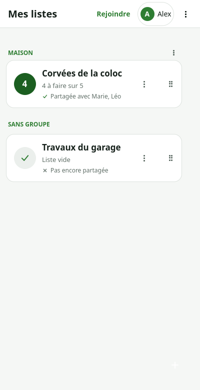
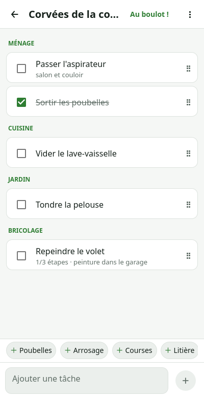
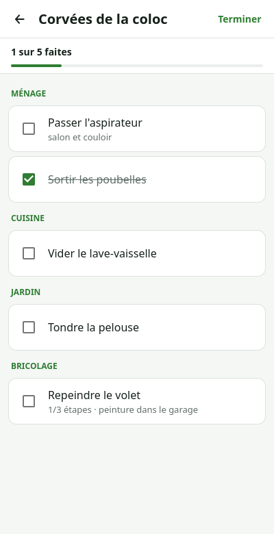

# Colo Tâches

**Liste de tâches partagée, chiffrée de bout en bout, sans compte et sans publicité.**

Créez une liste, partagez-la par QR code ou lien, découpez les tâches en étapes,
ajoutez des photos et suivez l'avancement à plusieurs. Les données sont chiffrées
sur l'appareil ; le relais ne voit que des blobs.

[](https://github.com/Poisson48/Colo_Taches/actions/workflows/ci.yml)

<p align="center">
  
  &nbsp;
  
  &nbsp;
  
</p>

## Télécharger

Dernière version : **[Releases](../../releases/latest)**

| Plateforme | Fichier | Ouverture |
|---|---|---|
| Linux x86-64 | `ColoTaches-*-x86_64.AppImage` | `chmod +x ColoTaches-*.AppImage && ./ColoTaches-*.AppImage` |
| Android arm64 | `colotaches-*-arm64.apk` | ouvrir l'APK, ou `adb install -r colotaches-*-arm64.apk` |

Les mises à jour Android s'installent par-dessus sans perdre les listes.

## Ce que fait l'app

- listes de tâches partagées, groupes de listes, partage par QR/lien ;
- tâches avec étapes cochables, progression, catégories, échéances, favoris ;
- photos par tâche (vignettes synchronisées, pas de HD) ;
- historique des tâches cochées ;
- mode Chantier plein écran, import/export CSV et ZIP ;
- hors ligne d'abord : file d'attente locale et reprise automatique.

## Architecture

- **Qt 6 / C++20 / QML**, SQLite local, Android arm64 + AppImage Linux.
- **Relais Nostr chiffré uniquement** : `wss://colo-apps.les-crevettes-cevenoles.fr`.
  Pas de P2P, pas de TURN, pas de WebRTC.
- **Chiffrement E2E** : XChaCha20-Poly1305, une clé de 32 octets par liste.
- **CRDT LWW par champ** avec horloges de Lamport : convergence sans conflit.
- **Notifications** : FCM (Google) **ou** UnifiedPush (ntfy, sans Google), ou mode
  différé sans Google. Aucun contenu de liste ne transite dans une notification.

## Documentation

| Document | Contenu |
|---|---|
| [PROTOCOL.md](PROTOCOL.md) | protocole complet : identifiants, crypto, Nostr, payloads, push |
| [docs/SYNC-SERVER.md](docs/SYNC-SERVER.md) | architecture serveur, relais, broker |
| [docs/NOTIFICATIONS.md](docs/NOTIFICATIONS.md) | modes, FCM/UnifiedPush, batterie, limites |
| [docs/SCALING.md](docs/SCALING.md) | dimensionnement |

## Build

### Desktop

```bash
bash scripts/setup-dev.sh
cmake -S . -B build -G Ninja
cmake --build build
ctest --test-dir build
```

Binaire : `build/src/colotaches`.

### Android arm64

```bash
bash scripts/setup-android.sh   # une fois (~7 Go)
bash scripts/build-android.sh   # → APK signé debug
```

Un APK de test signé release sans publication peut être produit par le workflow
GitHub `Test APK`.

### Release

```bash
git tag -a v0.x.y -m "notes de version" && git push origin v0.x.y
```

Le workflow construit l'APK + l'AppImage et publie la Release. Le `versionCode`
est supérieur à 10000 pour rester au-dessus des APK de test.

## État

Fork de [Colo_Course](https://github.com/Poisson48/Colo_Course), adapté aux tâches
avec étapes, photos et historique. Même architecture : relais chiffré, CRDT,
appairage QR, notifications FCM/UnifiedPush.

## Licence

GPLv3. Qt 6 (LGPL), libsodium (ISC), libsecp256k1 (MIT).
